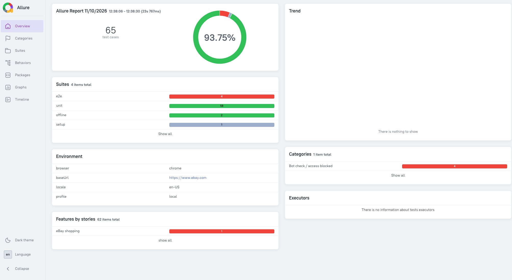

# ebay-e2e-playwright

Home assignment: an eBay purchase-under-budget flow with Playwright. Search for items under a max price, add them to the cart and check the cart total.

Written in TypeScript (approved instead of Python).



## How to run

Needs Node 20+, Google Chrome, and Java for the Allure CLI. Commands are for macOS or Linux.

```bash
npm install
npx playwright install chromium
cp .env.example .env

npm test                 # everything
npm run test:unit        # price parser, scenario data, bot-check rules
npm run test:offline     # bot-check handling against a mocked eBay
npm run test:e2e         # the eBay scenarios
npx playwright test --project=e2e --grep shoes-under-220

npm run test:report      # clean run + Allure report
```

To run signed in, put `EBAY_EMAIL` and `EBAY_PASSWORD` in `.env`. Without them the tests run as guest. `CLEAN_MODE=true` forces guest.

Test data is in `data/scenarios.json`, one test per row. `maxPrice` is in the scenario `currency`.

## Architecture

```
tests/        specs, auth setup, unit tests
src/flows     login, search, cart (the assignment functions)
src/pages     page objects; selectors in src/pages/locators
src/components header, price filter, pagination, variant picker
src/fixtures  builds pages and flows for each test
src/config    env, profiles (local / ci), timeouts
src/utils     price parser, bot check, network wait, logger
```

Specs only talk to flows, flows only talk to pages, and only pages and components know selectors. Result cards and prices are read with XPath. There are no hard waits; actions wait on URLs, network responses or visible elements.

The login runs once in a Playwright `setup` project and saves the session to `.auth/state.json`, which the e2e tests reuse.

## Assumptions and limitations

- eBay blocks automated browsers a lot (HTTP 403, "Pardon Our Interruption"). The test stops with `BotCheckError` and a screenshot, and Allure puts it under "Bot check / access blocked". The first page of a test is reloaded once; nothing else is retried, and captchas are not solved. `npm run test:offline` shows this behavior without eBay.
- If eBay blocks the sign-in, the tests continue as guest. Wrong credentials fail the setup.
- eBay sets the currency by IP (ILS from Israel). Prices in another currency fail the test.
- The budget is checked against the cart's items total, without shipping. The subtotal is attached to the report.
- A price range like "ILS 20 to ILS 35" counts by its upper bound.
- Size and color are picked at random from the available options; quantity stays at 1.
- Out-of-stock, ended and auction-only items are skipped, and the budget uses the number of items actually added.
- `addItemsToCart(urls, maxPrice?)` also checks the item price after picking variants and skips the item if it's over `maxPrice`. `addItemsToCart(urls)` works as in the assignment.
- Paging stops after 5 result pages locally and 3 on CI, so a search with very few matches can return fewer items than `limit`.
- The sign-in error and verification page texts were never seen live, because eBay blocked every automated sign-in.

The bug review for task 2 is in [ReadMeAIBugs.md](ReadMeAIBugs.md).

A run report is in `docs/report`: `index.html` (Allure, open it in a browser after downloading) and `junit.xml`.
